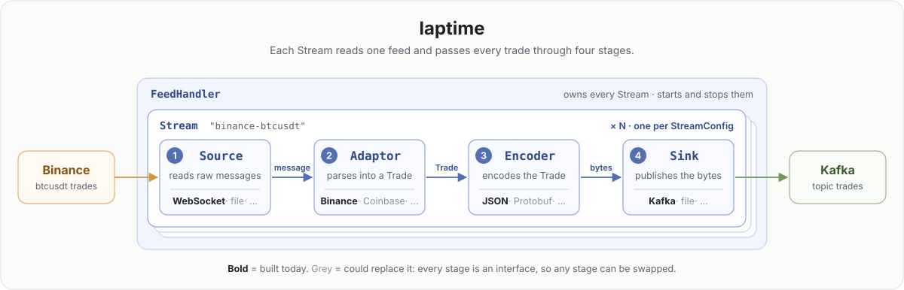

<div align="center">

# laptime

**Binance trades in, one normalized `Trade` in the middle, JSON out to Kafka.**

A small C++20 feed handler, built one concept at a time. This README describes the code as it is today.

<br>



<sub><i>Figure 1. Each Stream reads one feed and passes every trade through four stages, and any stage can be swapped.</i></sub>

</div>

## Reading the diagram

- **A Stream is four stages, in order.** Each message goes through all four:
  1. **`Source`** reads a raw message from the feed.
  2. **`Adaptor`** parses it into a `Trade`.
  3. **`Encoder`** turns the `Trade` into bytes.
  4. **`Sink`** publishes the bytes.

  The arrows carry exactly those three things: message, `Trade`, bytes.
- **Every stage is swappable.** Each stage is an interface. The table shows what's built today,
  and what could take its place without touching the other three stages:

  | Stage | Built today | Could also be |
  |---|---|---|
  | `Source` | `WebSocketSource`, `FileSource` (replays a file, one message per line) | a UDP multicast feed |
  | `Adaptor` | `BinanceAdaptor` | a Coinbase or Kraken parser |
  | `Encoder` | `ToJson` | Protobuf, SBE |
  | `Sink` | `KafkaSink`, `DiscardSink` (drops everything, for benchmarks) | a file |

  The WebSocket is part of the `Source` stage. It is how today's Source reads from Binance, not
  part of Binance.
- **`FeedHandler` owns the streams.** The stacked cards mean "many". `main.cc` builds one
  `StreamConfig` per feed, and `FeedHandler` creates one `Stream` for each, then starts and stops
  them all.

## Run it

You need a C++20 compiler (Apple clang from the Xcode Command Line Tools), CMake 3.30+,
OpenSSL 3 (`brew install openssl@3`) and Docker for Kafka. The C++ libraries are pinned and
downloaded by CMake on the first configure: [IXWebSocket](https://github.com/machinezone/IXWebSocket)
12.0.1, [librdkafka](https://github.com/confluentinc/librdkafka) 2.16.0,
[nlohmann/json](https://github.com/nlohmann/json) 3.12.0 and, for the benchmarks,
[Google Benchmark](https://github.com/google/benchmark) 1.10.0.

```bash
# 1. Kafka (single node) and the topic
docker run -d --name kafka -p 9092:9092 apache/kafka:4.3.1
docker exec kafka /opt/kafka/bin/kafka-topics.sh --bootstrap-server localhost:9092 \
    --create --if-not-exists --topic trades

# 2. Build
cmake -S . -B build -DCMAKE_BUILD_TYPE=Release
cmake --build build -j

# 3. Run. Ctrl+C stops it cleanly.
./build/laptime

# 4. In another terminal, watch the trades arrive (key = symbol)
docker exec -it kafka /opt/kafka/bin/kafka-console-consumer.sh --bootstrap-server localhost:9092 \
    --topic trades --formatter-property print.key=true
```

The program prints `Connection established` when the WebSocket opens. On exit it prints a
latency table per stream, in microseconds, then `% Kafka delivery stats: <n> delivered, <m> failed`.
From a recorded run:

```
binance-btcusdt                      count      min      p50      p90      p95      p99      max
  read + TLS (wake → read)             251      7.5     92.8    216.4    245.8    492.7   7706.8
  decode (read → t0)                   251      0.6      5.4     12.0     17.0     52.7    439.3
  parse, encode, enqueue (t0 → t1)   7'521      3.0     18.4     21.7     29.3    155.8  19719.2
  total (wake → t1)                  7'521     23.0    575.9   1506.5   1914.9   9724.4  21488.6
```

- **read + TLS** and **decode** happen inside IXWebSocket. A small patch,
  [third_party/ixwebsocket/receive-times.patch](third_party/ixwebsocket/receive-times.patch), which
  CMake applies, times them. One socket read can carry many messages, so these two rows count each
  read once.
- **parse, encode, enqueue** is laptime's own work, until the Kafka produce call returns.
- **total** runs from the moment the socket had data to the end of the enqueue. It includes any
  wait behind earlier messages from the same read.

None of it includes the network, the exchange, or Kafka delivery. Messages that contain no trades
are not counted. Each row keeps its first 10'000 samples, and the table says how many arrived after
that.

Every Kafka record also carries these times as headers (`laptime.wake_ns`, `laptime.read_ns`,
`laptime.start_ns`, `laptime.produce_ns`), so a reader downstream can time it too. To see them:

```bash
docker exec -it kafka /opt/kafka/bin/kafka-console-consumer.sh --bootstrap-server localhost:9092 \
    --topic trades --formatter-property print.headers=true
```

In **CLion**, open the folder and run the `laptime` target. The red Stop button sends SIGINT, which
triggers the same clean shutdown as Ctrl+C.

## Benchmarks

[bench/hot_path_bench.cc](bench/hot_path_bench.cc) uses Google Benchmark. It times each stage of the
per-message path on its own, on a real Binance trade message, and then the whole path on 1'000
trades from [testdata/](testdata/). Each row also says how many heap allocations it makes. The
build above already builds it. Use a Release build: numbers from a Debug build mean nothing.

```bash
cmake --build build --target laptime_bench
./build/laptime_bench --benchmark_repetitions=5 --benchmark_report_aggregates_only=true
```

In **CLion**, choose the Release profile and run the `laptime_bench` target. Medians of 5
repetitions on an Apple silicon Mac with 8 GB:

| Benchmark | What it times | Median | Heap allocations |
|---|---|---|---|
| `BM_SteadyNanos` | One `SteadyNanos()` clock reading | 15.6 ns | 0 |
| `BM_RecordSample` | 10'000 `RecordSample` calls into a fresh recorder | 4'029 ns, about 0.4 ns each | 0 |
| `BM_Parse` | `BinanceAdaptor::Parse`: JSON → `Trade` | 2'077 ns | 25 per trade |
| `BM_ToJson` | `ToJson`: `Trade` → JSON, written into a buffer | 1'570 ns | 19 per trade |
| `BM_ParseAndEncode` | Both together | 3'719 ns | 44 per trade |
| `BM_ReplayStream` | The whole `Stream` on 1'000 trades: `FileSource` → `OnMessage` → `DiscardSink` | 3.68 ms, so 3.68 µs per trade | 44 per trade |

- `BM_ReplayStream` costs the same per trade as `BM_ParseAndEncode`, in time and in allocations:
  the `Stream` around parsing and encoding adds almost no time and no allocations.
- **How allocations are counted.** The benchmark program replaces the global `operator new` with
  one that adds 1 to a counter and then calls `malloc`, and each benchmark reads the counter before
  and after its loop. All 44 allocations per trade come from parsing (25) and encoding (19), mostly
  nlohmann/json building its objects and strings. C libraries such as librdkafka call `malloc`
  directly, so Kafka's allocations wouldn't be counted. The replay doesn't use Kafka.
- Each row's label shows its allocations, also in the 5-repetition run, except for
  `BM_ReplayStream`: its label includes the time, which differs between repetitions, so the summary
  rows leave it out. A plain `./build/laptime_bench` shows it:
  `1000 trades per replay, … µs per trade and 44.0 allocations per trade`.
- The loops run the same messages over and over, warm in cache, and `BM_ReplayStream` sends to
  `DiscardSink`, not Kafka. So they're lower than the live `t0 → t1` row in the shutdown report,
  which also includes the timing headers, `produce()` and cold caches. Use them to compare code
  changes, not to predict live latency.
- [testdata/binance-btcusdt-trades.jsonl](testdata/binance-btcusdt-trades.jsonl) holds 1'000
  consecutive BTCUSDT trades (IDs 6840783756–6840784755). They were fetched from Binance's REST API
  (`/api/v3/historicalTrades`, in microseconds) and written in the WebSocket trade format, one
  message per line. The REST API has no event time, so `E` is a copy of `T`. Every other field
  matched the WebSocket's, compared on 1'445 trades recorded from it.
- Numbers move with machine load: a quieter run gave `BM_Parse` 1'482 ns. Compare medians from
  `--benchmark_repetitions`, not single runs.
- `--benchmark_min_time=10s` runs each benchmark for at least 10 s.
- On macOS, "Unable to determine clock rate" and "Failed to set thread affinity" are harmless.
- `-DLAPTIME_BUILD_BENCHMARKS=OFF` at configure time skips building them.

## Going deeper

[docs/deep-dive.md](docs/deep-dive.md) explains how it works inside: the four stages, the
`Trade` model, config and factories, ownership, threads, shutdown, what happens when
something goes wrong, how latency is measured, and the timing headers in Kafka.
