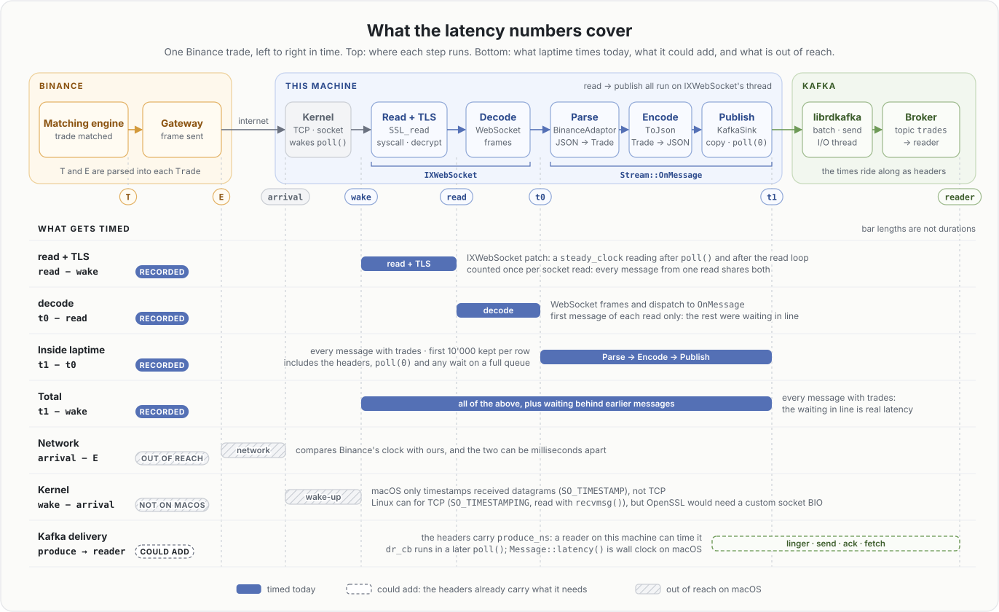

# laptime: deep dive

How laptime works inside. For the big picture, start with the [README](../README.md).

1. [A Stream is four stages](#1-a-stream-is-four-stages)
2. [One normalized `Trade`](#2-one-normalized-trade)
3. [Config is plain data](#3-config-is-plain-data)
4. [Factories: `std::visit` picks the class](#4-factories-stdvisit-picks-the-class)
5. [Ownership and lifetime](#5-ownership-and-lifetime)
6. [Threads: who runs what](#6-threads-who-runs-what)
7. [Clean shutdown](#7-clean-shutdown)
8. [What happens when something goes wrong](#8-what-happens-when-something-goes-wrong)
9. [Measuring latency](#9-measuring-latency)

## 1. A Stream is four stages

| Stage | Its job | Contract (interface) | Today | In → out |
|---|---|---|---|---|
| **Source** | Bring raw messages in from a feed (network, file, …) | `Source`: `Start()`, `Stop()`, calls `on_message(text)` | `WebSocketSource` | feed → `std::string_view` |
| **Adaptor** | Understand one exchange's format | `Adaptor`: `Parse(text)` → `std::vector<Trade>` | `BinanceAdaptor` | text → `Trade`s |
| **Encoder** | Turn a `Trade` into bytes | `Encoder`: a function pointer, `std::string (*)(const Trade&)` | `ToJson` | `Trade` → `std::string` |
| **Sink** | Deliver bytes somewhere (Kafka, file, …) | `Sink`: `Publish(key, value)`, `Flush()` | `KafkaSink` | bytes → destination |

Each stage changes for a different reason. A new exchange needs a new Adaptor. A new wire format
needs a new Encoder. A new destination needs a new Sink. A new transport needs a new Source.
Swapping one stage never touches the other three.

The stages are joined by `Stream::OnMessage`, which is the whole per-message path:

```cpp
void Stream::OnMessage(const std::string_view str) {
  const int64_t start = SteadyNanos();
  const std::vector<Trade> trades = adaptor_->Parse(str);
  for (const Trade& trade : trades) {
    sink_->Publish(trade.symbol, encoder_(trade));
  }
  // Messages with no trades (other events, bad JSON) would skew the numbers.
  if (!trades.empty()) recorder_.RecordSample(SteadyNanos() - start);
}
```

- `Parse` returns a **vector** because one frame may carry several trades. Binance sends one per
  frame. An empty vector means "nothing to publish" (for example, a frame that isn't JSON).
- The **Encoder is a plain function pointer**, not a class. It has no settings and no state, so
  there is no object to create or own, and calling it is an ordinary function call.
- **Each message is timed.** The two `SteadyNanos()` calls bracket the whole path, and the result
  goes into the stream's `LatencyRecorder`. Writing that sample is why `OnMessage` isn't `const`.
  The trades are kept in a named vector so the code can check afterwards whether there were any.
  See [§9](#9-measuring-latency).

## 2. One normalized `Trade`

Every exchange is turned into the same struct ([src/model/trade.h](../src/model/trade.h)). Everything
after the Adaptor only sees `Trade` and never knows which exchange it came from.

| Field | Binance key | Example | Notes |
|---|---|---|---|
| `exchange` | (none) | `"binance"` | Set by the adaptor |
| `symbol` | `s` | `"BTCUSDT"` | Also used as the Kafka key |
| `trade_id` | `t` | `6781614918` | Goes up by 1 per trade on each symbol |
| `price` | `p` | `84540.01` | Arrives as text (`"84540.01000000"`), parsed with `strtod` |
| `quantity` | `q` | `9e-05` | Arrives as text, parsed the same way |
| `taker_side` | `m` | `Side::kBuy` | `m` means "the buyer is the maker". `true` → the taker sold → `kSell` |
| `trade_time_us` | `T` | `1792611075432100` | When Binance matched the trade |
| `event_time_us` | `E` | `1792611075432177` | When Binance sent the frame |

Times are in microseconds because the URL asks for `timeUnit=MICROSECOND`.

## 3. Config is plain data

Each stage has one config struct per implementation. The structs are grouped in a
`std::variant`, so a config value holds exactly one of them:

```cpp
struct KafkaSinkConfig {
  std::string brokers;
  std::string topic;
};

using SinkConfig = std::variant<KafkaSinkConfig>;
// Later: std::variant<KafkaSinkConfig, DiscardSinkConfig>
```

`StreamConfig` holds one of each kind (`source`, `adaptor`, `encoder`, `sink`), and
`FeedHandlerConfig` holds a list of `StreamConfig`s. `main.cc` builds them with designated
initializers:

```cpp
const auto config = StreamConfig{
    .name = "binance-btcusdt",
    .source = WebSocketConfig{"wss://stream.binance.com:9443/ws/"
                              "btcusdt@trade?timeUnit=MICROSECOND"},
    .sink = KafkaSinkConfig{.brokers = "localhost:9092", .topic = "trades"},
    .adaptor = BinanceAdaptorConfig{},
    .encoder = JsonEncoderConfig{}};

FeedHandler feed{FeedHandlerConfig{.streams = {config}}};
```

A config only **describes** what to build. It never opens a socket and never creates anything.
All config types live in [src/model/config/](../src/model/config/). An empty struct such as
`BinanceAdaptorConfig{}` still matters: its **type** is what selects the implementation.

## 4. Factories: `std::visit` picks the class

Each kind has a factory header with one `…Of()` overload per config type, and one `Create…()`
function that dispatches between them:

```cpp
inline std::unique_ptr<Sink> SinkOf(const KafkaSinkConfig& config) {
  return std::make_unique<KafkaSink>(config);
}

inline std::unique_ptr<Sink> CreateSink(const SinkConfig& config) {
  return std::visit(
      [&](const auto& local_config) { return SinkOf(local_config); }, config);
}
```

`std::visit` looks inside the variant, finds the type it holds, and calls the `SinkOf` overload
for that type. Overload resolution happens at **compile time**, once for each type the variant can
hold. Add a type to the variant without adding its `…Of()` overload, and the `std::visit` line
**doesn't compile**. You can't get an "unknown type" error at runtime, and there is no `switch`
to keep up to date.

Factories hand back ownership: `CreateSource`, `CreateAdaptor` and `CreateSink` return a
`std::unique_ptr`, and `CreateEncoder` returns a function pointer.

## 5. Ownership and lifetime

- **One owner per object.** `FeedHandler` owns `std::vector<std::unique_ptr<Stream>>`, and each
  `Stream` owns its four stages. There is no `shared_ptr` anywhere.
- **Copying is deleted** on `FeedHandler`, `Stream`, `Sink` and `KafkaSink`. Each of them owns
  something real (a thread, a socket, a Kafka producer). A copy would mean two owners of one socket.
- **Why `unique_ptr<Stream>` and not `Stream` in the vector.** The source's callback captures
  `this` (the `Stream`), so a `Stream` must never move. On the heap its address stays fixed, even
  when the vector grows.
- **Declaration order is destruction order.** Members are destroyed bottom-up, so the source,
  which is declared last, is destroyed first. Its thread is gone before the recorder, adaptor and
  sink it uses are destroyed:

  ```cpp
  Encoder encoder_;
  LatencyRecorder recorder_;
  std::unique_ptr<Adaptor> adaptor_;
  std::unique_ptr<Sink> sink_;
  std::unique_ptr<Source> source_;  // declared last → destroyed first
  ```

- **Nothing runs during construction.** The `Stream` constructor creates the source last, and the
  source only connects when `Start()` is called. No message can arrive before all four stages exist.

## 6. Threads: who runs what

| Thread | Started by | What it runs |
|---|---|---|
| **main** | the OS | Builds everything, sleeps in 100 ms steps, then runs the whole shutdown and prints the latency report |
| **IXWebSocket's thread** (one per stream) | `ix::WebSocket::start()` | Connecting and reconnecting, reading frames, and **our whole per-message path**: `OnMessage` → `Parse` → `ToJson` → `Publish` |
| **librdkafka's threads** | `RdKafka::Producer::create()` | Batching, sending to the broker, retries |

- **No locks in our code.** Each stream's per-message work runs on that stream's own socket
  thread, and streams share nothing. The only cross-thread values are the stop flag (an atomic),
  librdkafka's internal queue (librdkafka does its own locking), and the latency samples (next
  point).
- **Latency samples cross threads once.** The socket thread writes them in `OnMessage`. The main
  thread reads them only after `Stop()` has joined that thread, so the join is all the
  synchronization needed. Reading them while the stream runs would be a data race.
- **`Publish` is an enqueue, not a network send.** `produce()` copies the bytes (`RK_MSG_COPY`) into
  librdkafka's queue and returns. The `std::string` from the encoder can be destroyed right away.
- **Key = symbol.** With `PARTITION_UA`, librdkafka picks the partition by hashing the key, so all
  trades of one symbol land in one partition, in order.
- **Delivery reports.** The broker's yes or no for each message comes back through `dr_cb`, which
  librdkafka calls inside `poll()`. That happens in `Publish` (`poll(0)`, socket thread) and in
  `Flush` (main thread). The two never overlap, because the socket thread has been joined before
  `Flush` runs.

## 7. Clean shutdown

**The signal handler only sets a flag.** A signal can interrupt the program in the middle of
anything, including a `malloc`. Inside a handler, only lock-free atomics are safe. So the
handler stores `true` into a `std::atomic<bool>` (`static_assert`-ed to be lock-free) and
nothing more. The main thread notices within 100 ms and leaves its loop. The handler also
resets the signal to its default, so a **second Ctrl+C kills the process at once**, in case a
shutdown hangs.

**The order is written out in `Run()`.** After the loop, `Run()` stops the feed, and only then
prints the latency report:

```cpp
feed.Stop();  // joins the WebSocket thread, so the samples are final
feed.ReportLatency(std::cout);
```

`FeedHandler::Stop()` calls `Stop()` on every stream:

```cpp
void Stream::Stop() {
  if (stopped_) return;  // FeedHandler and ~Stream() both call Stop()
  stopped_ = true;
  source_->Stop();  // 1. no new messages: close the socket, join its thread
  sink_->Flush();   // 2. then wait (≤ 10 s) for Kafka to confirm the rest
}
```

Stopping the source first means that once the flush starts, nothing new can be published.
`Stop()` is **idempotent**, meaning a second call does nothing, because `Run()`, `~FeedHandler` and
`~Stream` all call it. The report is printed from `Run()`, not from a destructor, so the whole
shutdown reads top to bottom in one place. When `Run()` returns, the members are destroyed (source
first), and `~KafkaSink` prints the delivery stats.

## 8. What happens when something goes wrong

| Situation | What happens |
|---|---|
| A frame that isn't JSON | Parsed with exceptions off (`Json::parse(text, nullptr, false)`): 0 trades, the frame is skipped |
| `p` or `q` isn't a number | `ToDouble` returns `std::nullopt`, and the frame is skipped |
| The connection drops | IXWebSocket reconnects on its own, waiting up to 10 s between tries |
| librdkafka's queue is full | `Publish` waits (`poll(1000)`) and retries. This blocks the socket thread (back-pressure) |
| Kafka rejects a message | Printed when it happens, counted, and totalled at exit |
| A Kafka setting is invalid | The `KafkaSink` constructor throws at startup and the program stops before anything runs |

## 9. Measuring latency



Each stream times its own per-message path. After shutdown, `Run()` prints one table per stream:
min, p50, p90, p95, p99 and max, in nanoseconds.

- **What one sample covers.** `OnMessage` reads `SteadyNanos()` (a wrapper around
  `std::chrono::steady_clock`, which never jumps) when IXWebSocket calls it (`t0`), and again after
  the last `Publish` returns (`t1`). That is parsing, encoding and the Kafka enqueue. It includes
  `Publish`'s `poll(0)`, which can run delivery reports for earlier messages, and any wait on a full
  librdkafka queue. Messages that carry no trades aren't timed.
- **Recording never allocates.** `LatencyRecorder` allocates its whole vector in the constructor
  (10'000 samples by default). `RecordSample` only writes the next slot, and it is defined in the
  header so it can be inlined into `OnMessage`. Once the vector is full, further samples are
  counted, and the report says how many weren't recorded.
- **Nearest-rank percentiles.** For p%, `GetSummary()` sorts a copy and takes the sample at index
  `(p * n - 1) / 100`: the smallest sample with at least p% of all samples at or below it. Every
  percentile is a value that was actually measured. With fewer than 100 samples, p99 is the max.
- **`T` and `E` are context, not a measurement.** Binance stamps `T` when it matches the trade and
  `E` when it sends it. Both are parsed into each `Trade`, but nothing is timed from them.

What isn't timed, and what it would take (the bottom rows of the diagram):

| Stretch | Status | Why |
|---|---|---|
| IXWebSocket: read + TLS, then decode | Could add | A small patch to IXWebSocket: one `steady_clock` reading after `poll()` returns and one after the read loop, on the same clock and thread as `t0`. Messages that arrive in the same read share both readings. |
| Kafka delivery | Could add | librdkafka keeps it for every message: `Message::latency()`, read in `dr_cb`, runs from `produce()` until `dr_cb` runs inside a later `poll()`, not until the broker's ack. |
| Network | Out of reach | It compares Binance's `E` with our clock, and the two can be milliseconds apart. |
| Kernel wake-up | Out of reach on macOS | macOS only timestamps received datagrams (`SO_TIMESTAMP`), not TCP. Linux has `SO_TIMESTAMPING` for TCP, read with `recvmsg()`, but OpenSSL's socket reads don't use `recvmsg()`, so it would need a custom socket BIO. |
